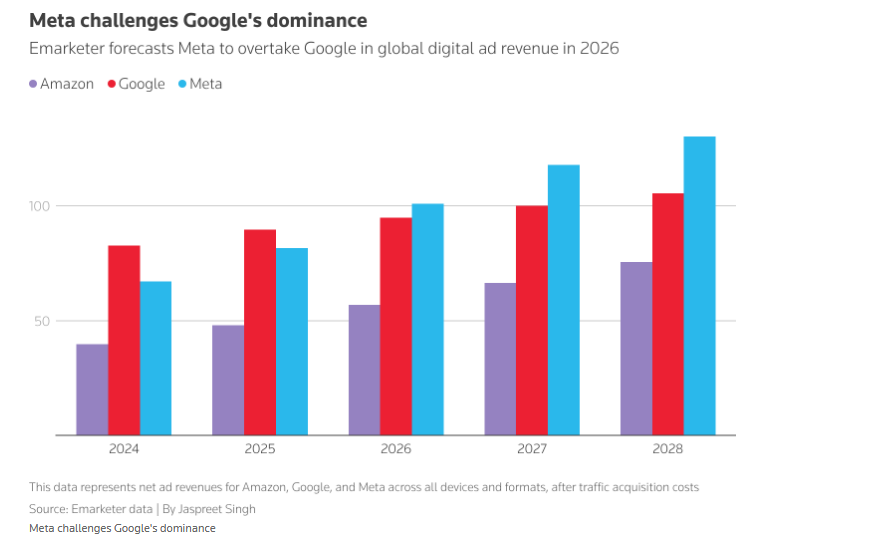
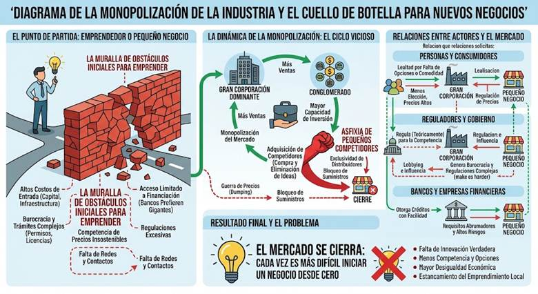

# Paso 1. La Semilla de la Indignación

## Problemática elegida

**Monopolización de las industrias frente a los negocios emergentes.**

Elegimos esta problemática porque las grandes empresas tecnológicas concentran cada vez más recursos, usuarios y canales de publicidad, dificultando que los nuevos negocios puedan competir en igualdad de condiciones. Esta situación genera barreras de entrada para emprendedores, reduce la competencia y limita las oportunidades de innovación dentro de los mercados digitales.

---

# Paso 2. Autopista del Problema

## a) Evento

En 2025, un juez de Estados Unidos determinó que Google incurrió en prácticas anticompetitivas dentro del mercado de publicidad digital. Este caso evidenció cómo una empresa dominante puede influir considerablemente en un mercado del que dependen miles de pequeños negocios para promocionarse.

**Fuente:** Reuters (2025). *Google viola ley antimonopolios con su publicidad en línea, resuelve juez en EU.*

## b) Patrón y Tendencia

### ¿Es recurrente?

Sí. La concentración del mercado de publicidad digital se ha mantenido durante varios años en manos de un pequeño grupo de empresas tecnológicas. La gráfica muestra cómo Google, Meta y Amazon concentran gran parte de los ingresos publicitarios digitales a nivel mundial.

Fuente: [Reuters](https://www.reuters.com/business/media-telecom/meta-poised-surpass-google-digital-ad-revenue-first-time-report-says-2026-04-13/)

### ¿Está empeorando?

Sí. Según las proyecciones de Emarketer, Meta superará a Google en ingresos publicitarios digitales a partir de 2026; sin embargo, ambas empresas, junto con Amazon, continúan incrementando sus ingresos año tras año. Esto indica que el mercado sigue concentrándose en unas cuantas plataformas dominantes, dificultando la competencia para nuevos negocios.

**Fuente de la gráfica:** Emarketer, citada por Reuters.

## c) Mapeo de Actores y Redes

### Relaciones principales entre actores

- Los anunciantes pagan a las plataformas tecnológicas por espacios publicitarios.
- Los consumidores utilizan los servicios ofrecidos por las grandes plataformas.
- Los negocios emergentes dependen de dichas plataformas para obtener visibilidad.
- Los gobiernos regulan las actividades de las empresas tecnológicas.

### Estructura (Actores)

- Grandes empresas tecnológicas.
- Negocios emergentes y emprendedores.
- Consumidores.
- Anunciantes.
- Gobiernos y organismos reguladores.

## d) Paradigmas, Modelos Mentales y Comportamientos

### Modelos Mentales

#### Grandes empresas

- Mantener el liderazgo del mercado genera mayores beneficios.
- La expansión constante es necesaria para seguir creciendo.

#### Negocios emergentes

- Es difícil competir contra empresas consolidadas.
- Dependen de plataformas dominantes para obtener visibilidad.

#### Consumidores

- Prefieren servicios conocidos y de fácil acceso.
- Dan prioridad a la comodidad y popularidad de las plataformas.

#### Anunciantes

- Prefieren invertir en las plataformas con mayor alcance.
- Consideran menos riesgoso anunciarse en empresas ya consolidadas.

#### Gobiernos y organismos reguladores

- Buscan equilibrar la competencia económica con la innovación.
- Suelen intervenir cuando el problema ya es significativo.

### Paradigma que sostiene el problema

El éxito empresarial se asocia con el crecimiento constante y la concentración de recursos, por lo que las empresas dominantes buscan ampliar continuamente su participación en el mercado para mantener su ventaja competitiva.

---

# Paso 3. Aterrizando el Problema

## 1. Perspectiva del Usuario y Límites

### Usuario Afectado

Emprendedores y propietarios de pequeños negocios que buscan crecer y competir en mercados digitales dominados por grandes empresas tecnológicas.

### Límites

#### Fuera de nuestro control

- Regulaciones gubernamentales.
- Decisiones de las grandes corporaciones.
- Condiciones del mercado global.

#### Limitaciones

- Capital reducido.
- Menor acceso a publicidad.
- Escasos recursos tecnológicos.

## 2. Criterios de Éxito

### Cuantitativos

- Aumentar en un 20% la tasa de supervivencia de los negocios emergentes.
- Reducir en un 15% los costos de promoción y publicidad para pequeños negocios.

### Cualitativos

- Mayor igualdad de oportunidades.
- Mercados más competitivos.
- Más opciones para consumidores y emprendedores.

## 3. Problem Statement

Los negocios emergentes y emprendedores enfrentan dificultades para competir en el mercado de publicidad digital y comercio electrónico, donde unas cuantas empresas tecnológicas concentran usuarios, datos y canales de promoción. Esta situación se ha intensificado durante los últimos años, incrementando las barreras de entrada y los costos de visibilidad para nuevos participantes, quienes deben destinar una proporción creciente de sus recursos a publicidad para mantenerse competitivos. Como consecuencia, se reducen las oportunidades de crecimiento, la competencia y la innovación dentro del mercado digital.

---

# Paso 4. Evaluación de las "Soluciones" Actuales

Demandas antimonopolio y regulaciones gubernamentales contra empresas tecnológicas dominantes como Google.

## ¿Es deseable?

Sí. Busca promover una competencia más justa y reducir las barreras para nuevos participantes del mercado.

## ¿Es factible?

Parcialmente. Los gobiernos cuentan con herramientas legales para investigar y sancionar prácticas monopólicas, pero los procesos suelen ser largos y complejos.

## ¿Es viable?

Parcialmente. Aunque las sanciones pueden limitar ciertas conductas anticompetitivas, las grandes empresas conservan ventajas significativas gracias a sus recursos, usuarios y acceso a datos.

## Conclusión crítica

Las regulaciones antimonopolio resultan deseables porque buscan promover una competencia más justa; sin embargo, presentan limitaciones de factibilidad debido a la complejidad y duración de los procesos legales, así como problemas de viabilidad, ya que las grandes empresas mantienen ventajas estructurales basadas en recursos, datos y millones de usuarios. Por ello, las soluciones actuales no han logrado reducir de forma significativa las barreras que enfrentan los negocios emergentes, permitiendo que continúe la concentración del mercado digital.